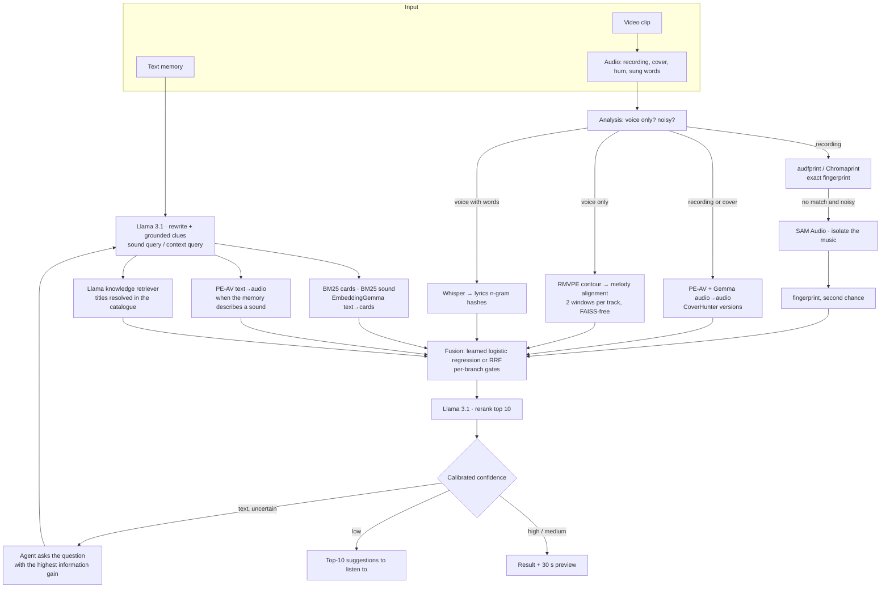
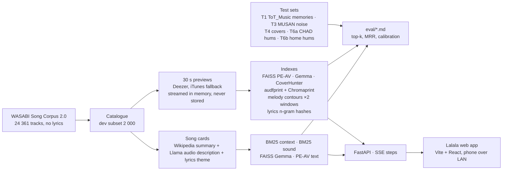

# Lalala — find the song Shazam can't

**Meta Global AI Developer Hackathon** (Oct 26 – Nov 4, 2026) · Indie track · theme *Build for Your World*

Shazam needs the exact recording. Lalala finds a song from what people actually have: **a hummed tune**, **a few sung
words**, **a vague memory** ("the one with the whistling in a car ad, around 2008"), **a cover or a live version**, or
**a phone recording in a noisy bar**. It runs an investigation instead of a lookup: several search branches vote, a
calibrated confidence decides between one answer and a top-10 to listen to, and an agent asks the question that
reduces uncertainty the most when it hesitates.

Everything runs **locally on a laptop** (Apple Silicon M2, 24 GB) on **Meta open-weights models**: Llama 3.1, PE-AV,
SAM Audio and FAISS. Code name in the sources: *SoundTrace*. Day-by-day journal: [`RAPPORT.md`](RAPPORT.md) (French).

## Meta models at the core

| Meta component | Model | What it does in Lalala |
|---|---|---|
| **Llama 3.1** (open weights, 8B via Ollama; any hosted Llama through `LLM_BASE_URL`) | `llama3.1:8b` | Understands the memory: rewrites it into a *sound* query and a *context* query, keeps only clues grounded in the user's words, reranks the candidates, acts as a knowledge retriever, generates the 24 361 **song cards** (audio description + lyrics theme, never the lyrics), drives the investigation agent and its information-gain questions |
| **PE-AV** (Perception Encoder Audio-Visual) | `facebook/pe-av-large` | Audio↔audio and text↔audio embeddings: the audio index for noisy recordings, covers and sound descriptions ("whistling", "piano and a female voice") |
| **SAM Audio** | `facebook/sam-audio-base` (MLX port on Apple Silicon, official PyTorch runner too) | Isolates the music from a noisy recording with the prompt "music"; gives the fingerprint a second chance |
| **FAISS** | `IndexFlatIP` | Every vector index (PE-AV, EmbeddingGemma, CoverHunter, hum2song) |

Supporting open components, clearly secondary: EmbeddingGemma 2 (text↔cards, local), CoverHunter (cover versions),
RMVPE (pitch tracking for humming), faster-whisper (sung words), audfprint / Chromaprint (exact fingerprints), BM25.
Gemini Embedding 2 is an optional extra embedder and the system runs with `USE_GEMINI=false`.

## How a query flows



An exact fingerprint match short-circuits everything (the Shazam case). For a hummed tune the melody branch decides
alone: fusing it with the other audio branches destroys it (measured).

## The project in one picture



```
api/        FastAPI: /api/search (SSE steps, Lalala contract), /session/* (agent), query persistence
catalog/    WASABI extraction, Deezer/iTunes previews, song cards (Wikipedia + Llama)
core/       embedders/ (PE-AV, Gemma, CoverHunter, hum2song, CLAP, Gemini), FAISS index, BM25,
            fingerprints, melody alignment, ASR + lyrics hashes, Llama rewrite / rerank / retriever,
            fusion (RRF, learned), SAM Audio wrapper, device (mps/cpu), disk cache
finder/     investigation agent: tools, Bayesian belief, information-gain questions, simulated user
testsets/   builders for T1, T3, T4, T6a, T6b (answers never reach a prompt)
scripts/    build_* (catalogue, cards, embeddings, index, fingerprints, contours, lyrics hashes),
            eval_* (retrieval, isolation, agent), train_* (fusion, cross-encoder), record_queries, synth_hums
eval/       measured reports (retrieval, fusion, cross-encoder, SAM Audio, agent, test sets, catalogue)
web/        Lalala front: Capture → Searching (live steps, model names) → Result / Suggestions
tests/      pytest (92) · web/tests Vitest · web/e2e Playwright
```

## Results on the dev panel (2 000 tracks + targets, laptop only)

| Scenario | Set | Best single branch | Fused | Reads as |
|---|---|---|---|---|
| Vague memory (text) | T1, 43 ToT_Music queries | EmbeddingGemma text→cards 11.6 % top-1 / 25.6 % top-10 | learned fusion **14 % top-1 / 30 % top-5** (RRF 9 % / 21 %) | a shortlist, not one answer |
| Noisy recording | T3, 30 clips at 0 / 5 / 10 dB | audfprint 87 % top-1 | RRF **93 % top-1 / 100 % top-5** (PE-AV consolidates) | solid |
| Cover / live | T4, 44 pairs | Gemma 18 % top-1 / 25 % top-5 | RRF 32 % top-10 | below our demo threshold |
| Hummed tune | T6a, 393 real CHAD hums | melody alignment **19.6 % top-1 / 29.8 % top-10**, MRR 0.23 | melody decides alone | works when the hummed passage is inside the 30 s window |
| Synthetic hums | T6b, 6 | melody 100 % | | the pipeline is right, the 30 s window is the ceiling |

What the numbers taught us (details in [`eval/`](eval/) and [`RAPPORT.md`](RAPPORT.md)):

- **Humming**: the learned hum2song embedder failed even on synthetic hums rendered from the song's own melody
  (0.5 % top-1 on CHAD). Direct contour alignment is 30× better; adding a second 30 s window per track (iTunes
  preview) took it from 16.0 % to 19.6 % top-1. Confidence comes from the top-1/top-2 **margin**, calibrated on CHAD
  (margin ≥ 0.05 → 77 % precision), because the raw score does not discriminate.
- **SAM Audio**: generative separation is not sample-faithful; isolated audio *hurts* fingerprints and embeddings on
  average but rescues cases nothing else gets, so it is used as a second chance only.
- **Llama 8B** invents clues from one word ("guitar" → rock, male vocals): clues are now kept only when grounded in the
  user's words, and sound words (instruments, voice, tempo) query audio descriptions, never titles or lyrics.
- Tried and dropped on the numbers: a home-trained cross-encoder (lower top-1), lyrics themes in the cards (no gain), CLAP.

## Quickstart

```bash
uv sync                                   # Python 3.11, PyTorch on MPS
brew install chromaprint ollama ffmpeg
ollama pull llama3.1:8b && ollama serve &
cp .env.example .env                      # LLM_BASE_URL, HF_TOKEN (SAM Audio), optional keys
uv run python scripts/check_setup.py && uv run pytest

# Build the dev catalogue and indexes (previews are streamed, nothing is written to disk)
uv run python scripts/build_catalog.py && uv run python scripts/resolve_previews.py
uv run python scripts/build_cards.py --subset dev                 # Llama descriptions + themes (~7 h on a laptop)
uv run python scripts/build_embeddings.py --embedder peav,gemma,coverhunter --modality audio --subset dev
uv run python scripts/build_embeddings.py --embedder gemma,peav --modality text --subset dev
uv run python scripts/build_index.py --subset dev                 # BM25 context + sound
uv run python scripts/build_fingerprints.py --engine audfprint    # and chromaprint
uv run python scripts/build_contours.py --subset dev && uv run python scripts/build_contours.py --subset dev --provider itunes
uv run python scripts/build_lyrics_hashes.py

# Run
SOUNDTRACE_SUBSET=dev SOUNDTRACE_FUSION=learned uv run uvicorn api.main:app --port 8000
cd web && pnpm install && VITE_API_MODE=live pnpm dev             # http://localhost:5173 ; pnpm dev:lan for a phone
```

Evaluate: `uv run python scripts/build_testsets.py`, then `uv run python scripts/eval_retrieval.py --subset dev`
(writes `eval/retrieval.md`), `scripts/eval_isolation.py` (SAM Audio), `scripts/eval_finder.py` (agent),
`scripts/train_fusion.py` (learned fusion vs RRF).

Front options: `?replay=memory|cover|noisy` (fallback scenes), `?scale=1.25` (projector), long press on the logo for the replay menu.

## Configuration (`.env`)

| Variable | Default | Effect |
|---|---|---|
| `LLM_BASE_URL`, `LLM_MODEL`, `LLM_API_KEY` | Ollama, `llama3.1:8b` | OpenAI-compatible client; point it at any hosted Llama |
| `EMBEDDERS` | `gemma,peav,gemini,coverhunter,hum2song` | active embedders (a missing index is ignored) |
| `USE_GEMINI` | `true` | optional Gemini Embedding 2; `false` works without changes |
| `SOUNDTRACE_TEXT_TO_AUDIO` | `auto` | text→audio only when the rewrite detects a sound description |
| `SOUNDTRACE_LLM_RETRIEVER`, `LLM_RETRIEVER_MODEL`, `SOUNDTRACE_LLM_MIN_CONF` | `1`, `LLM_MODEL`, `0.6` | Llama knowledge retriever (a bigger Llama changes everything here) |
| `SOUNDTRACE_RERANK`, `RERANK_MODE` | `1`, `pointwise` | Llama rerank; `listwise` for bigger models |
| `SOUNDTRACE_FUSION` | `rrf` | `learned` uses `data/index/fusion_lr.pkl` |
| `SOUNDTRACE_ASR_MODEL` | `small` | faster-whisper size for sung words |
| `SAM_AUDIO_ENGINE` | `auto` | `mlx`, `torch`, `off` |
| `HF_TOKEN` | | gated SAM Audio weights (never committed) |
| `PREVIEW_STORAGE` | `memory` | no audio on disk; `disk` only if the provider's terms allow it |
| `OMP_NUM_THREADS`, `KMP_DUPLICATE_LIB_OK` | `1`, `TRUE` | set by `core/__init__.py`: faiss + torch ship two OpenMP runtimes on macOS |

## SAM Audio on Apple Silicon

The official `sam-audio` package pulls `perception_models` (which installs a top-level `core` package clashing with
ours) plus `decord` / `xformers` without macOS wheels. It lives in its own venv and is called as a subprocess
(`core/isolate.py` → `scripts/sam_runner*.py`), never imported in the API process.

- **MLX** (recommended): `uv venv data/raw/sam_audio/venv_mlx --python 3.11 && uv pip install --python data/raw/sam_audio/venv_mlx/bin/python -U mlx-audio`, weights `mlx-community/sam-audio-base`. 38 s per 10 s clip, 8.4 GB peak.
- **Official PyTorch**: `git clone https://github.com/facebookresearch/sam-audio data/raw/sam_audio/repo` then `scripts/sam_install.sh` (eva-decord, `--no-deps` perception-models, xformers stub, `transformers<5`, `huggingface_hub<1`). 145 s per clip on MPS, same quality.

## Data, licences, privacy

- **WASABI Song Corpus 2.0** (Zenodo 10.5281/zenodo.5603369, CC BY-NC 4.0, Buffa et al. ESWC 2021), extracted without lyrics. **ToT_Music** (Spotify Research, CC0) for memories, **MUSAN** (CC BY 4.0) for noise, **CHAD** hummings (CC BY-NC 4.0; YouTube originals are never downloaded, only public titles).
- **30 s previews** come from the Deezer API (iTunes Search fallback). Deezer's developer terms forbid local storage of the audio, so previews are decoded in memory, embedded, and dropped; only vectors are kept. Playback in the app uses the official preview URL.
- **No lyrics stored**: sung words are matched through one-way 64-bit hashes of word 4-grams.
- **Nothing leaves the machine** unless `USE_GEMINI=true` (previews and user recordings then go to Google) or the web branch gets a search key.
- Test-set answers never appear in a prompt; the simulated user is fenced from them.
- CoverHunter code (`alanngnet/CoverHunterMPS`) and checkpoint have no declared licence: experimental, local use only. RMVPE weights from `lj1995/VoiceConversionWebUI`, hum2song weights CC BY 4.0.

## Documents

[`RAPPORT.md`](RAPPORT.md) day-by-day journal · [`DEMO.md`](DEMO.md) demo script and decisions · [`PLAN.md`](PLAN.md),
[`PLAN_COMPLEMENTS.md`](PLAN_COMPLEMENTS.md) execution plan · [`FRONT_PLAN.md`](FRONT_PLAN.md) front plan ·
[`eval/`](eval/) measured reports · [`CLAUDE.md`](CLAUDE.md) project rules.
